<div align="center">


<br />

[](https://balu.is-a.dev/)
[](https://t.me/Abdulaziz6301)
[](https://www.linkedin.com/in/abdulaziz-abdujalilov-436a4a250/)
[](mailto:abdushkin2001@gmail.com)

</div>

```console
balu@tashkent:~$ status --availability
[ OPEN ] remote contract work: AI systems, legacy modernization, full-stack, bots
[ TZ   ] UTC+05:00, overlaps with Europe mornings and US early mornings
```

### `❯ cd ~/niche-engineering`

Research-grade open source in hard-to-hire domains. Protocol first, reproducible results, every claim backed by a test.

<table>
  <tr>
    <td width="50%" valign="top">
      <a href="https://github.com/abdulazizbalu/cobol-equiv">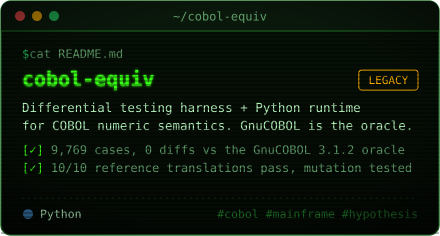</a>
      <br /><sub><a href="https://github.com/abdulazizbalu/cobol-equiv">code</a> · <a href="https://github.com/abdulazizbalu/cobol-equiv/blob/main/docs/benchmark.md">benchmark</a> · <a href="https://github.com/abdulazizbalu/cobol-equiv/blob/main/results/SUMMARY.md">results</a></sub>
    </td>
    <td width="50%" valign="top">
      <a href="https://github.com/abdulazizbalu/pricing-crosscheck">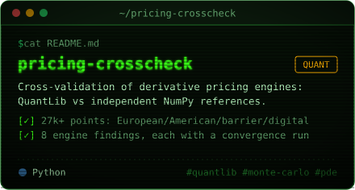</a>
      <br /><sub><a href="https://github.com/abdulazizbalu/pricing-crosscheck">code</a> · <a href="https://github.com/abdulazizbalu/pricing-crosscheck/blob/main/docs/findings.md">findings</a> · <a href="https://github.com/abdulazizbalu/pricing-crosscheck/blob/main/docs/protocol.md">protocol</a></sub>
    </td>
  </tr>
  <tr>
    <td width="50%" valign="top">
      <a href="https://github.com/abdulazizbalu/quasar-solver">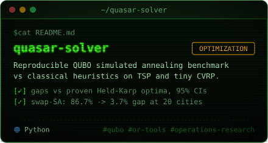</a>
      <br /><sub><a href="https://github.com/abdulazizbalu/quasar-solver">code</a> · <a href="https://abdulazizbalu.github.io/quasar-solver/demos/web_demo.html">route demo</a> · <a href="https://github.com/abdulazizbalu/quasar-solver/blob/main/benchmarks/results/summary.md">benchmark</a></sub>
    </td>
    <td width="50%" valign="top">
      <a href="https://github.com/abdulazizbalu/nur">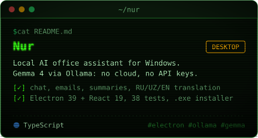</a>
      <br /><sub><a href="https://github.com/abdulazizbalu/nur">code</a> · <a href="https://github.com/abdulazizbalu/nur/releases">download .exe</a> · <a href="https://github.com/abdulazizbalu/nur#readme">docs</a></sub>
    </td>
  </tr>
</table>

### `❯ cd ~/telegram-web-a`

<table>
  <tr>
    <td width="50%" valign="top">
      <a href="https://telegram-tt-xi.vercel.app">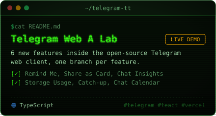</a>
      <br /><sub><a href="https://telegram-tt-xi.vercel.app">live demo</a> · <a href="https://github.com/abdulazizbalu/telegram-tt/branches">feature branches</a></sub>
    </td>
    <td width="50%" valign="top">

```txt
$ git branch --list 'feature/*'
  feature/remind-me      reminders on any message
  feature/message-card   message as a PNG card
  feature/chat-insights  story-style chat stats
  feature/storage-usage  media cache breakdown
  feature/catch-up       summary of unread messages
  feature/chat-calendar  activity heatmap calendar
```

Built into the open-source [Telegram Web A](https://github.com/Ajaxy/telegram-tt) client, each feature in its own branch, all of them running together in the live demo.

  </td>
  </tr>
</table>

### `❯ cd ~/ai-systems`

<table>
  <tr>
    <td width="50%" valign="top">
      <a href="https://github.com/abdulazizbalu/ai-eval-lab">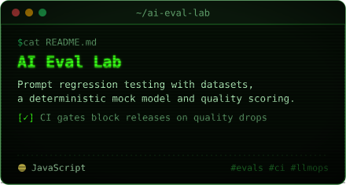</a>
      <br /><sub><a href="https://abdulazizbalu.github.io/ai-eval-lab/">live demo</a> · <a href="https://github.com/abdulazizbalu/ai-eval-lab">code</a> · <a href="https://github.com/abdulazizbalu/ai-eval-lab/releases/tag/v1.2.0">v1.2.0</a></sub>
    </td>
    <td width="50%" valign="top">
      <a href="https://github.com/abdulazizbalu/rag-knowledge-agent">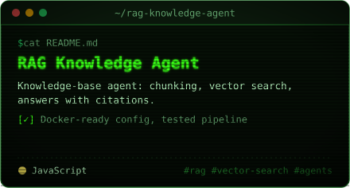</a>
      <br /><sub><a href="https://abdulazizbalu.github.io/rag-knowledge-agent/">live demo</a> · <a href="https://github.com/abdulazizbalu/rag-knowledge-agent">code</a> · <a href="https://github.com/abdulazizbalu/rag-knowledge-agent/releases/tag/v1.2.0">v1.2.0</a></sub>
    </td>
  </tr>
  <tr>
    <td width="50%" valign="top">
      <a href="https://github.com/abdulazizbalu/agent-workflow-studio">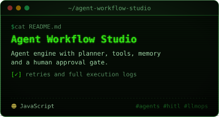</a>
      <br /><sub><a href="https://abdulazizbalu.github.io/agent-workflow-studio/">live demo</a> · <a href="https://github.com/abdulazizbalu/agent-workflow-studio">code</a> · <a href="https://github.com/abdulazizbalu/agent-workflow-studio/releases/tag/v1.2.0">v1.2.0</a></sub>
    </td>
    <td width="50%" valign="top">
      <a href="https://github.com/abdulazizbalu/ai-campaign-orchestrator">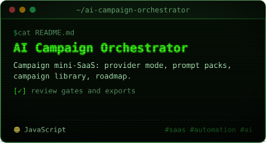</a>
      <br /><sub><a href="https://abdulazizbalu.github.io/ai-campaign-orchestrator/">live demo</a> · <a href="https://github.com/abdulazizbalu/ai-campaign-orchestrator">code</a> · <a href="https://github.com/abdulazizbalu/ai-campaign-orchestrator/releases/tag/v1.2.0">v1.2.0</a></sub>
    </td>
  </tr>
</table>

### `❯ cd ~/llmops`

| module | what it does | run |
|---|---|---|
| [`llmops-release-guard`](https://github.com/abdulazizbalu/llmops-release-guard) | CI release guard for AI services: health, budget, rollback and model policy checks | [demo](https://abdulazizbalu.github.io/llmops-release-guard/) |
| [`ai-observability-kit`](https://github.com/abdulazizbalu/ai-observability-kit) | latency, token usage, model cost, success rate, error budget burn | [demo](https://abdulazizbalu.github.io/ai-observability-kit/) |
| [`rag-deploy-blueprint`](https://github.com/abdulazizbalu/rag-deploy-blueprint) | production-style RAG deploy: Docker, health checks, config validation, runbooks | [demo](https://abdulazizbalu.github.io/rag-deploy-blueprint/) |

### `❯ cat ~/stack`


### `❯ git log --oneline --focus`

```diff
+ research-grade open source in niche domains: COBOL migration testing, quant validation, optimization
+ local-first AI desktop apps for Russian and Uzbek speaking users
+ new features for the Telegram Web A client
+ Telegram bots, Mini Apps and Next.js products for clients
+ evals, RAG, agents and release safety for every AI feature
- demos without tests
```

### `❯ ls ~/field-notes`

| file | about |
|---|---|
| [`prompt-engineering-playbook.md`](https://gist.github.com/abdulazizbalu/3cd84c83c898687af6059fab88e9b007) | prompt patterns, schemas, critic loops, product-ready AI workflows |
| [`llm-evaluation-checklist.md`](https://gist.github.com/abdulazizbalu/30c746dc93f9b751b3b0cc8504ef65b0) | quality checklist for testing AI features before shipping |
| [`rag-system-blueprint.md`](https://gist.github.com/abdulazizbalu/fb1082fb28fa4dfc4c98c6da23215ac4) | retrieval, chunking, metadata, citations and monitoring |
| [`ai-devops-ci-cd.md`](https://gist.github.com/abdulazizbalu/fdfd6e495363303cd48e79cc5aed4181) | CI/CD for AI apps: prompt tests, eval smoke checks, release safety |
| [`digital-media-growth-system.md`](https://gist.github.com/abdulazizbalu/5384a8934cdbbbed9b7e82559c90e9e0) | AI, content strategy, analytics and tooling as one growth system |

### `❯ watch -n 43200 ./contributions`

<picture>
  <source media="(prefers-color-scheme: dark)" srcset="https://raw.githubusercontent.com/abdulazizbalu/abdulazizbalu/output/snake-terminal-dark.svg" />
  <source media="(prefers-color-scheme: light)" srcset="https://raw.githubusercontent.com/abdulazizbalu/abdulazizbalu/output/snake-terminal-light.svg" />
  
</picture>

<br />

